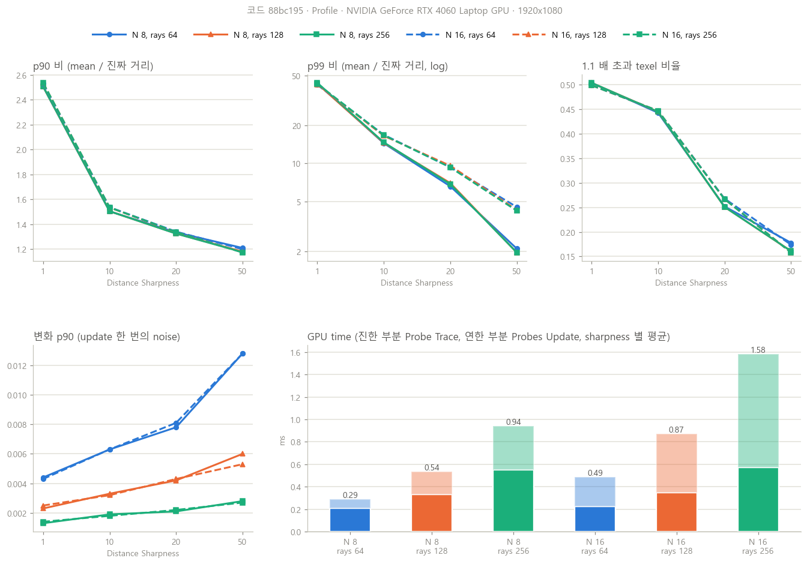

# Probe visibility 측정 기록

Probe visibility 작업이 잰 값 중 다시 재면 바뀌거나 다시 재기 비싼 것을, 잰 조건과 함께 남긴다.

- 항목은 그 값을 잰 script 가 덧붙인다. 덧붙이기만 하고, 고치거나 지우지 않는다.
- 코드 열은 잴 때의 HEAD 다. `+` 는 commit 하지 않은 변경이 있었다는 뜻이다.

## Distance Sharpness, distance 해상도, ray 수

`python scripts/measure-probe-distance.py --record` 가 덧붙인다. 표에 없는 조건은 그 script 가 정한다.

- N 은 Distance Texels per Side, rays 는 Rays per Probe, sharpness 는 Distance Sharpness 다.
- p50, p90, p99 는 texel 마다 distance mean 을 진짜 거리로 나눈 비의 백분위다. 진짜 거리는 texel 방향으로 쏜 ray 하나가 맞은 거리 (Probes Texel Distance) 다. 비가 1 보다 크면 mean 이 맞은 면보다 멀다.
- 1.1 배 초과는 그 비가 1.1 을 넘는 texel 의 비율이다.
- 변화 p90 은 수렴한 뒤 update 한 번에 바뀐 mean 을 진짜 거리로 나눈 값의 90 백분위다.
- Probe Trace 와 Probes Update 는 Profiler 의 GPU time 평균이다.
- 그래프는 `python scripts/plot-probe-distance.py` 가 이 표에서 그린다. 같은 조건의 줄이 여럿이면 가장 아래 줄을 그린다. `--record` 도 줄을 덧붙인 뒤 다시 그린다.

| 날짜 | 코드 | config | GPU | scene | N | rays | sharpness | p50 | p90 | p99 | 1.1 배 초과 | 변화 p90 | Probe Trace (ms) | Probes Update (ms) |
|---|---|---|---|---|---|---|---|---|---|---|---|---|---|---|
| 2026-11-15 | 88bc195 | Profile | NVIDIA GeForce RTX 4060 Laptop GPU | 1920x1080 | 8 | 64 | 1 | 1.107 | 2.507 | 43.455 | 0.504 | 0.0044 | 0.209 | 0.099 |
| 2026-11-15 | 88bc195 | Profile | NVIDIA GeForce RTX 4060 Laptop GPU | 1920x1080 | 8 | 64 | 10 | 1.073 | 1.504 | 14.481 | 0.443 | 0.0063 | 0.208 | 0.094 |
| 2026-11-15 | 88bc195 | Profile | NVIDIA GeForce RTX 4060 Laptop GPU | 1920x1080 | 8 | 64 | 20 | 1.051 | 1.335 | 6.583 | 0.252 | 0.0078 | 0.208 | 0.067 |
| 2026-11-15 | 88bc195 | Profile | NVIDIA GeForce RTX 4060 Laptop GPU | 1920x1080 | 8 | 64 | 50 | 1.024 | 1.210 | 2.102 | 0.178 | 0.0128 | 0.208 | 0.067 |
| 2026-11-15 | 88bc195 | Profile | NVIDIA GeForce RTX 4060 Laptop GPU | 1920x1080 | 8 | 128 | 1 | 1.107 | 2.507 | 43.039 | 0.504 | 0.0023 | 0.333 | 0.204 |
| 2026-11-15 | 88bc195 | Profile | NVIDIA GeForce RTX 4060 Laptop GPU | 1920x1080 | 8 | 128 | 10 | 1.073 | 1.505 | 14.592 | 0.445 | 0.0033 | 0.332 | 0.204 |
| 2026-11-15 | 88bc195 | Profile | NVIDIA GeForce RTX 4060 Laptop GPU | 1920x1080 | 8 | 128 | 20 | 1.051 | 1.326 | 6.987 | 0.251 | 0.0042 | 0.332 | 0.204 |
| 2026-11-15 | 88bc195 | Profile | NVIDIA GeForce RTX 4060 Laptop GPU | 1920x1080 | 8 | 128 | 50 | 1.021 | 1.180 | 1.957 | 0.161 | 0.0060 | 0.331 | 0.204 |
| 2026-11-15 | 88bc195 | Profile | NVIDIA GeForce RTX 4060 Laptop GPU | 1920x1080 | 8 | 256 | 1 | 1.107 | 2.508 | 43.824 | 0.504 | 0.0013 | 0.553 | 0.388 |
| 2026-11-15 | 88bc195 | Profile | NVIDIA GeForce RTX 4060 Laptop GPU | 1920x1080 | 8 | 256 | 10 | 1.074 | 1.505 | 14.725 | 0.445 | 0.0019 | 0.551 | 0.388 |
| 2026-11-15 | 88bc195 | Profile | NVIDIA GeForce RTX 4060 Laptop GPU | 1920x1080 | 8 | 256 | 20 | 1.051 | 1.325 | 6.859 | 0.251 | 0.0021 | 0.553 | 0.388 |
| 2026-11-15 | 88bc195 | Profile | NVIDIA GeForce RTX 4060 Laptop GPU | 1920x1080 | 8 | 256 | 50 | 1.021 | 1.176 | 1.961 | 0.161 | 0.0028 | 0.554 | 0.388 |
| 2026-11-15 | 88bc195 | Profile | NVIDIA GeForce RTX 4060 Laptop GPU | 1920x1080 | 16 | 64 | 1 | 1.098 | 2.532 | 42.195 | 0.499 | 0.0043 | 0.225 | 0.264 |
| 2026-11-15 | 88bc195 | Profile | NVIDIA GeForce RTX 4060 Laptop GPU | 1920x1080 | 16 | 64 | 10 | 1.068 | 1.537 | 16.903 | 0.447 | 0.0063 | 0.222 | 0.264 |
| 2026-11-15 | 88bc195 | Profile | NVIDIA GeForce RTX 4060 Laptop GPU | 1920x1080 | 16 | 64 | 20 | 1.048 | 1.341 | 9.347 | 0.268 | 0.0081 | 0.223 | 0.264 |
| 2026-11-15 | 88bc195 | Profile | NVIDIA GeForce RTX 4060 Laptop GPU | 1920x1080 | 16 | 64 | 50 | 1.024 | 1.200 | 4.507 | 0.174 | 0.0128 | 0.223 | 0.264 |
| 2026-11-15 | 88bc195 | Profile | NVIDIA GeForce RTX 4060 Laptop GPU | 1920x1080 | 16 | 128 | 1 | 1.098 | 2.537 | 42.598 | 0.499 | 0.0025 | 0.349 | 0.525 |
| 2026-11-15 | 88bc195 | Profile | NVIDIA GeForce RTX 4060 Laptop GPU | 1920x1080 | 16 | 128 | 10 | 1.068 | 1.535 | 16.598 | 0.447 | 0.0032 | 0.348 | 0.525 |
| 2026-11-15 | 88bc195 | Profile | NVIDIA GeForce RTX 4060 Laptop GPU | 1920x1080 | 16 | 128 | 20 | 1.048 | 1.337 | 9.592 | 0.267 | 0.0043 | 0.349 | 0.525 |
| 2026-11-15 | 88bc195 | Profile | NVIDIA GeForce RTX 4060 Laptop GPU | 1920x1080 | 16 | 128 | 50 | 1.021 | 1.175 | 4.270 | 0.158 | 0.0053 | 0.348 | 0.525 |
| 2026-11-15 | 88bc195 | Profile | NVIDIA GeForce RTX 4060 Laptop GPU | 1920x1080 | 16 | 256 | 1 | 1.098 | 2.537 | 42.968 | 0.499 | 0.0014 | 0.575 | 1.009 |
| 2026-11-15 | 88bc195 | Profile | NVIDIA GeForce RTX 4060 Laptop GPU | 1920x1080 | 16 | 256 | 10 | 1.068 | 1.536 | 16.798 | 0.447 | 0.0018 | 0.573 | 1.009 |
| 2026-11-15 | 88bc195 | Profile | NVIDIA GeForce RTX 4060 Laptop GPU | 1920x1080 | 16 | 256 | 20 | 1.048 | 1.338 | 9.311 | 0.267 | 0.0022 | 0.575 | 1.009 |
| 2026-11-15 | 88bc195 | Profile | NVIDIA GeForce RTX 4060 Laptop GPU | 1920x1080 | 16 | 256 | 50 | 1.021 | 1.173 | 4.211 | 0.158 | 0.0027 | 0.575 | 1.009 |
